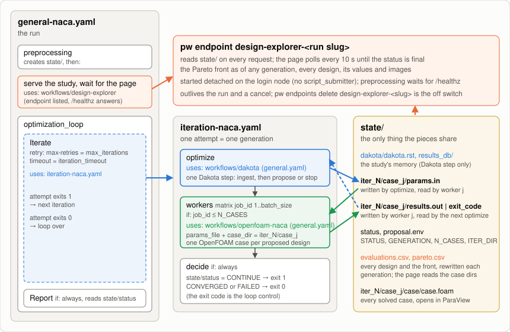
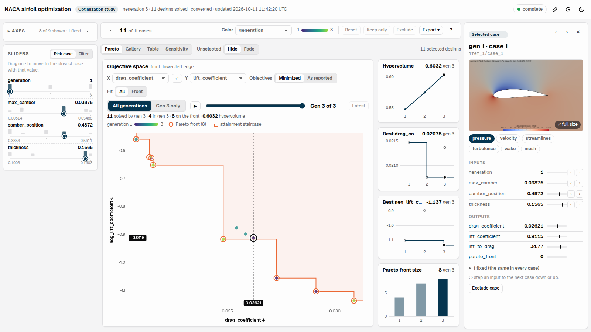

# Dakota-OpenFOAM Optimization

NACA airfoil shape optimization as a loop of two standalone workflows:

| Piece | Workflow | Called by |
|---|---|---|
| propose designs or stop | [`workflows/dakota`](../dakota/README.md) | the `optimize` job of `iteration-naca.yaml` |
| solve one design | [`workflows/openfoam-naca`](../openfoam-naca/README.md) | the `workers` matrix of `iteration-naca.yaml`, once per design |
| serve the study live | [`workflows/design-explorer`](../design-explorer/README.md) | `preprocessing` |

Their READMEs describe the optimizer, the evaluator, the page and their inputs;
this one covers only the loop and the live page. The loop mechanics come from
[`tutorials/optimization`](../../tutorials/optimization/README.md).

## How the pieces connect



```
general-naca.yaml
 ├─ preprocessing       state/ (the study); checks that the OpenFOAM and Dakota environments deliver
 │                      their tools; calls design-explorer over state/, which serves it and waits until
 │                      its endpoint is listed and /healthz answers through the platform
 └─ optimization_loop   needs the page, then:
     ├─ Iterate         retried step; each attempt runs iteration-naca.yaml once:
     │                    optimize ──▶ workers-1..batch_size ──▶ decide
     │                    dakota step   openfoam-naca   exit 1 = next cycle, exit 0 = done
     └─ Report          if: always — verdict from state/status, the page URL
```

The two subworkflows only share files under `state/`:

1. `optimize` calls the Dakota step with the problem, the knobs and
   `state_dir`; the step ingests `iter_<N-1>/case_*/{results.out,exit_code}`
   and writes `iter_<N>/case_<j>/params.in` plus `proposal.env`, which the next
   step publishes as outputs.
2. `workers` is a matrix of `batch_size` slots (a literal list of 8 sliced at
   submission); slot *j* runs when `j <= N_CASES` and calls the OpenFOAM workflow
   with `case.params_file = ITER_DIR/case_j/params.in` and
   `case.case_dir = ITER_DIR/case_j`; the cluster, mesh, angle and environment
   settings pass straight through. The call leaves `results.out` or `exit_code`
   in that directory.
3. `decide` turns `state/status` into the exit code the parent's retry loops on.

Every case is therefore exactly a standalone `openfoam-naca` run: its own
checkout and environment check (lock-serialized install), its own submitter job,
and a `case/case.foam` that opens in ParaView, for every design of every
generation.


## The live page

`design-explorer-<run slug>` (in `pw endpoints list` and on the run page) is
[`workflows/design-explorer`](../design-explorer/README.md) serving the study
directory, called from preprocessing, so the page is live from the first
generation and a server that cannot start fails the run before any case is
spent. It reads the case directories and the optimizer's `problem.json` and
`state.json` on every request, and polls every 10 s until Dakota's status is
final.



- **Pareto**, the first view for an optimization: drag (↓) against lift (↑),
  every solved design colored by generation, the front ringed with its
  attainment staircase. The scrubber replays the study generation by
  generation (▶), and the convergence cards show the hypervolume, the best
  drag and lift so far and the front's size per generation. Hover a design
  for its values and image, click it to open it in the case panel.
- One axis per design variable and coefficient, plus **generation** and
  **pareto_front** (1 for the designs no other design beats on both drag and
  lift); the scrubber is a brush on generation, so every view follows it. The
  angle of attack is fixed, so its axis starts hidden.
- A case appears as soon as it solved. Failed designs have no outputs and are
  counted, not plotted.

**The endpoint outlives the run**: after the optimization finishes, or after a
cancel, it keeps showing the final study until `pw endpoints delete
design-explorer-<run slug>` removes it (that kills `pw endpoints run` and the
server under it). The design-explorer workflow removes its own server when its
endpoint never answered. A cancel mid-generation kills the running cases and
SLURM jobs and leaves only the endpoint.

## Images (optional)

Turn on **Generate images?** (off by default) and every case renders its flow
fields with ParaView (pressure, velocity, streamlines, eddy viscosity, wake,
mesh); the page then shows them in its gallery, its case panel and on hover.
ParaView comes from **ParaView environment commands** or, left empty, from the
official binaries downloaded once; rendering adds about 5 s per case.

## Running it

Pick the resource, set `max_iterations`, `batch_size`, `stall_generations` and
`mesh_scale`, and choose login node or scheduled cases with `Cores per case`
(the solver caps the ranks at one per 1,000 cells, so 16 cores need `mesh_scale`
2 or more; preprocessing warns when a request exceeds that, and the openfoam-naca
README has the measurements).
The **Design Problem** group holds the angle of attack, the variable bounds and
the Dakota seed.

**The names connect the pieces.** Dakota writes each name of **Design
variables** into every proposed `params.in`, and openfoam-naca reads them by
name ([its design names](../openfoam-naca/README.md#design-names)). So keep the
three names `max_camber`, `camber_position` and `thickness`. **Angle of attack**
is not a design variable: every case gets it as openfoam-naca's
`angle_of_attack` field. A misspelled name fails every case of the first
generation with an error that lists openfoam-naca's four names, and the loop
ends FAILED.

The form's defaults are the demo:
login node, `mesh_scale` 2, 4 × 10, about 20 min. **Load saved inputs →
`mesh3_slurm_4ranks`** is the converged-mesh study: SLURM, 4 ranks per case,
`mesh_scale` 3, 8 × 10, 31 min on gcpsmall.

The run succeeds only when the optimizer wrote `CONVERGED`. The front is
`state/pareto.csv` and `state/pareto.svg` in the run's job directory, every
case under `state/iter_<N>/case_<j>/`, the history on the page and in
`state/evaluations.csv`. The retried `Iterate` step shows only its last
attempt; each worker's log is three jobs deep (`workers-<k>` → `preprocessing`,
`run_case`, `results`). `iteration_timeout` (default 2d) caps one generation
because the platform's default retry timeout is 30 s per attempt.
