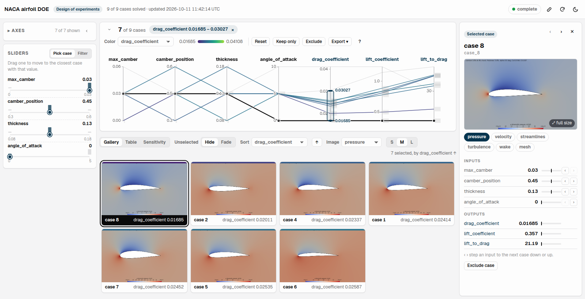

# Design Explorer

Parallel coordinates over a design study in the manner of
[Design Explorer](https://tt-acm.github.io/DesignExplorer/), served as the
endpoint `design-explorer-<run slug>`: the design variables and the outputs as
axes, the images and animations of every design, in a full-width page styled
for the platform, light or dark. Any workflow that
evaluates designs in case directories can call it as a subworkflow. For example,
[`doe-openfoam`](../doe-openfoam/README.md) and
[`dakota-openfoam`](../dakota-openfoam/README.md) serve their OpenFOAM airfoil
studies with it; the figure shows a doe-openfoam study.



- **Brush** an axis (drag along it) to select a range, and combine brushes
  across axes; drag a brush to move it, its ends to resize it, click the axis
  to clear it. Drag a title to reorder the axes; click it to color or sort by
  that variable, flip the axis or hide it. Every brush and slider shows as a
  chip above the chart, removable from there.
- Variables with one value in every case (a study that varies a few of many
  parameters) stay off the chart, the sliders and the pickers; their values
  fold into a **Fixed** group of the axes list and of the case panel.
- A full-window layout: the chart stays in view while the lists below it
  scroll, the bar between them resizes the chart, the chart folds to its
  toolbar (▾) so the Pareto view or the gallery gets the window, the sidebar
  folds away, and
  the light and dark themes are ACTIVATE Studio's (neutral gray, navy accent).
- **Color** colors the lines, cards, swatches and points by any variable; click
  its gradient to pick the palette (Viridis by default; Plasma, Inferno,
  Cividis, Blue–Red diverging, Blues) or reverse it.
- The chart always shows every case, the unselected ones in gray behind the
  selection. **Unselected: Hide | Fade** over the lists below lists only the
  selected cases, or every case with the others faded in place. The axes keep their range while you filter; **Keep only**
  and **Exclude** remove cases for good, and the axes rescale to what is left.
- **Click a line** (hover shows its values and image), a thumbnail or a table
  row to select that case. It opens in the case panel at the right, which stays
  open while you keep brushing and sliding: its images and animations, its
  values with where each sits in its range, and ‹ › beside each input to step
  to the case with the next lower or higher value of it, the other inputs held
  as close as the brushed cases allow. ← → step through the list, Esc closes.
- **Sliders**, two behaviors. **Pick case** (the default, Design Explorer's
  own): one thumb per input at the selected case's value, stepping through
  the values the brushed cases take, so the sliders drill down from the chart;
  drag one to move to the case with that value closest to the selected one,
  and the other sliders follow. **Filter**: a range per axis that narrows the
  brushed cases further; drag the shaded range to slide a window through the
  values. Each slider's histogram shows how the brushed cases spread.
- For a Dakota study, a **Pareto** view comes first: the objective space (each
  objective's sense from the optimizer's `problem.json`; **Objectives:
  Minimized** shows them as Dakota minimizes them, openfoam-naca's drag ↓
  against `neg_lift_coefficient` ↓, so the front is the familiar lower-left
  curve, and **As reported** shows lift itself ↑) with the front ringed and its
  attainment staircase, a
  generation scrubber at its top that replays the study (▶) and shows all the
  generations up to the scrubbed one or **only** that one (a brush on
  generation, so every view follows it; all of them by default), and convergence cards: the hypervolume from
  `state.json`, the best of each objective so far and the front's size per
  generation. Hover a design for its values and image, click it to open it.
- Below the chart, the cases as a **Gallery** (sized S/M/L, sorted by
  any variable, any image kind; an animation plays on hover), a **Table** (sort
  by a column) or a **Sensitivity** grid: every output against every input,
  with a least-squares line and Pearson's r, each panel tinted by r². **Export**
  downloads the selection as CSV.
- **The view is kept**: the address bar holds the brushes, slider ranges,
  exclusions, the open case, the axes, colors, sort, the list and the Pareto
  settings, so a refresh comes back to it and the link icon in the header
  copies a link that opens the same view for anyone who can reach the
  endpoint. **Export** also saves the selection as CSV and the chart, the
  Pareto view or the sensitivity grid as PNG images.
- Hover any control or term for its definition (hypervolume, Pareto front,
  attainment staircase, Pearson's r, the slider behaviors, and so on).
- The page follows the study: it reads it again while cases are running,
  and for three minutes after the last write, since a case is solved before
  its images are rendered. An image is listed once it has not been written
  to for 3 seconds, so no browser takes half of one.

## The study directory

**Study directory** is the absolute path of the study on the resource. Design
Explorer only reads it: the workflow that runs the study creates it and passes
the same path to its evaluator and to this workflow. For example,
[`doe-openfoam`](../doe-openfoam/README.md) passes `<job dir>/cases` and
[`dakota-openfoam`](../dakota-openfoam/README.md) passes `<job dir>/state`.

Inside it, a case is a folder in one of exactly two places:

| Layout | Case ID | For example | Extra axes |
|---|---|---|---|
| `case_<j>/` | `case_3` | the cases [`doe`](../doe/README.md) writes | none |
| `iter_<N>/case_<j>/` | `iter_2/case_3` | a [`dakota`](../dakota/README.md) state directory | **generation** (`N`) and **pareto_front**: 1 for the designs no other beats on every `results.out` value, all minimized as Dakota minimizes them |

**Folders anywhere else are ignored without a warning.** `run_1/`,
`gen_1/case_1/` or a case nested deeper never show, and the page waits as if
the study had not started. A study counts as a Dakota one when it has an
`iter_*` folder or Dakota's `status`, `state.json` or `problem.json`.

Each case folder holds:

```
case_<j>/
├── params.in      the design, one <value> <name> line per variable: the in: axes
├── results.out    the outputs, same format: the out: axes; values = solved
├── exit_code      without results.out: the evaluation failed
└── images/*       optional: one image kind per file name, a picture (png, jpg,
                   gif, webp, svg) or an animation (gif, mp4, webm)
```

A case with neither `results.out` nor `exit_code` is still running. The page
links an image as `<case ID>/images/<file>`, the same in both layouts; two files
with the same stem (`flow.gif`, `flow.mp4`) are two kinds, named by the file.
[`openfoam-naca`](../openfoam-naca/README.md)'s outputs, `drag_coefficient` and
`neg_lift_coefficient`, show as the drag and lift coefficients and their ratio.

The server reads the directory again on every request, so it can start before
the first case exists and shows each case as it lands. A `case_<j>/` study is
finished when no case is running. A Dakota study is finished only when its
`status` says CONVERGED or FAILED, because between two generations no case runs
but more are coming. A variable that never changes starts hidden. **Links** adds
buttons to the header, one `<label>=<URL>` per line, for example a
documentation page or a related study.

## Running it

Run it by itself to explore a study that already ran: pick the resource and give
the study's absolute path, for example a doe-openfoam run's `cases/` under its
job directory (`~/pw/jobs/<run>/`). A workflow that runs the study calls it as a
subworkflow before its evaluations start, so the page follows them. This is how
doe-openfoam does it:

```yaml
- name: Design Explorer (Serve the Study)
  if: ${{ inputs.postprocessing.generate_images == true }}
  uses: github/parallelworks/workflows@canary
  with:
    $yaml: workflows/design-explorer/yamls/general.yaml
    resource: ${{ inputs.resource }}
    study:
      cases_dir: ${{ needs.preprocessing.outputs.CASES_DIR }}
      title: NACA airfoil DOE
```

The server only runs on the login node, so it is started detached rather than
through the submitter. The run completes once the endpoint is listed and its
`/healthz` answers, and the endpoint keeps serving after the run until
`pw endpoints delete design-explorer-<run slug>`. A server whose endpoint never
answered is removed by the run's `stop_server_if_unhealthy` job. Nothing is
installed: the page is self-contained and the server is standard library
Python, so the login node needs no internet access.

## Files

| `app/` | Role |
|---|---|
| `design-explorer.html` | the page: parallel coordinates on a canvas, sliders, gallery, table, sensitivity grid, case panel |
| `design-explorer-server.py` | serves the page, the images and animations (with byte ranges, for video) and the tables |
| `study.py` | reads a study into `results.csv` and Design Explorer's `data.csv`; doe-openfoam's results job uses it too |

All standard library Python; [software/design-explorer.md](../../.claude/skills/activate-workflows/references/software/design-explorer.md)
has the notes on the data format, the page and its canvas performance.
